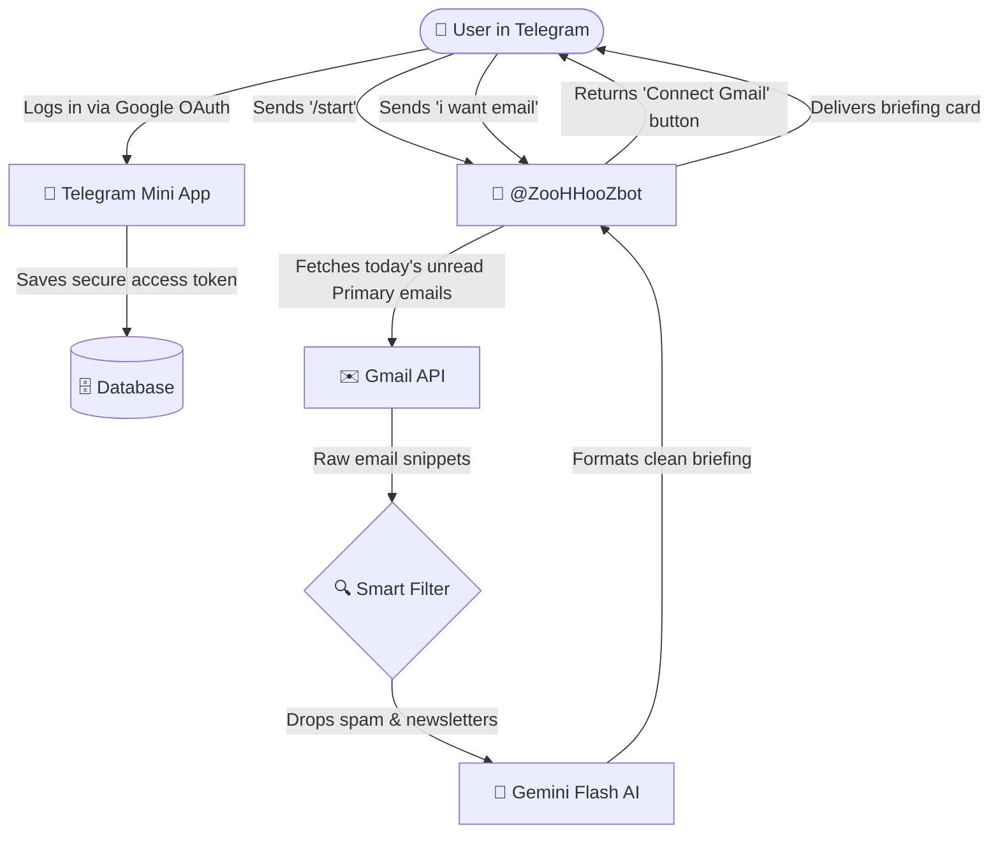

# 📬 emailZooH — AI-Powered Telegram Gmail Assistant

A simple, fast, and secure Telegram bot that connects to your Gmail and delivers clean **AI summaries** of your **unread Primary emails received today** on demand.

No spam, no promotional clutter, no complex installations — it runs 100% in the cloud on **Vercel**.

---

## 💡 What Does This Project Do?

Most people receive dozens of promotional emails, newsletters, and automated alerts every day. Finding the actual important emails takes time.

**emailZooH solves this:**
1. You text the Telegram bot `@ZooHHooZbot`: **`i want email`**.
2. The bot checks your Gmail inbox in real-time.
3. It filters out **100% of marketing, newsletters, and spam**.
4. It only selects genuine personal/work emails **received today**.
5. Google's **Gemini AI** reads the emails and generates a clean, concise bulleted briefing directly in your Telegram chat!

---

## 🔄 How It Works (Visual Flow)



---

## ✨ Key Features

| Feature | Description |
| :--- | :--- |
| **📱 Telegram Mini App** | 1-click Google sign-in directly inside Telegram without leaving the app. |
| **🛡️ 100% Primary Only** | Drops emails with `List-Unsubscribe`, `Feedback-ID`, or `bulk` headers so promotions never appear. |
| **📅 Today Only** | Only summarizes emails that arrived on the current calendar day. |
| **⚡ Gemini AI Briefing** | Groups messages into **🔴 Action Required** and **🟢 General Messages** with 1-sentence takeaways. |
| **☁️ 100% Serverless** | Hosted live on **Vercel** — runs 24/7 in the cloud without needing your computer on. |

---

## 📱 How to Use It (End-User Guide)

### Step 1: Open the Bot
Open Telegram and search for: **`@ZooHHooZbot`**

### Step 2: Connect Your Gmail
1. Send: `/start`
2. Tap the **🔗 Connect Gmail** button that appears.
3. Sign in to your Google Account and tap **Allow** (read-only access).
4. The window will say **"✅ Connected!"** and automatically close.

### Step 3: Get Your AI Briefing
Whenever you want to check your emails, send any of these messages:
* `i want email`
* `give email`
* `unread`

Within 3 seconds, you will receive a clean summary card like this:

> 📬 **TODAY'S PRIMARY INBOX BRIEFING**  
> 🗓️ *Wednesday, Nov 18, 2026*  
>  
> 🔴 **Action Required**  
> • **Professor Raman** — *Submit final project report by 11:59 PM tonight.*  
>  
> 🟢 **General Messages**  
> • **HR Team** — Shortlisted for interview round 2 scheduled for Friday.

---

## 📁 Project Structure (At a Glance)

```
gmail-updates/
├── api/
│   └── index.py             # Vercel Serverless entrypoint & path router
├── backend/
│   ├── app.py               # Main FastAPI server (webhooks, auth, routes)
│   ├── config.py            # App settings and environment variables
│   ├── database.py          # Dual storage engine (SQLite + Supabase)
│   ├── gmail_service.py     # Gmail OAuth & RFC header filtering logic
│   ├── ai_service.py        # Gemini Flash AI summarization prompt
│   └── telegram_service.py  # Telegram message sender & Mini App buttons
├── frontend/
│   ├── index.html           # Telegram Mini App popup UI
│   └── privacy.html         # Public Privacy Policy for Google compliance
├── vercel.json              # Vercel deployment & rewrite configuration
├── requirements.txt         # Python dependencies
└── PROJECT_GUIDE.md         # This guide!
```

---

## ⚙️ Environment Variables Explained

These keys power the application:

| Variable | What It Does | Where to Get It |
| :--- | :--- | :--- |
| `TELEGRAM_BOT_TOKEN` | Authorizes the bot to receive messages and reply | Created via `@BotFather` on Telegram |
| `GOOGLE_CLIENT_ID` | Identifies your Google OAuth app | [Google Cloud Console](https://console.cloud.google.com/) |
| `GOOGLE_CLIENT_SECRET` | Secret key to verify Google OAuth | [Google Cloud Console](https://console.cloud.google.com/) |
| `GEMINI_API_KEY` | Powers AI summarization with Gemini Flash | [Google AI Studio](https://aistudio.google.com/) |
| `BASE_URL` | Public production URL (`https://email-zoo-h.vercel.app`) | Auto-configured on Vercel |

---

## 🔒 Privacy & Security

* **Read-Only Permission:** The bot uses `https://www.googleapis.com/auth/gmail.readonly`. It can **never** send, delete, or modify your emails.
* **No Email Storage:** Your emails are analyzed in memory on-demand and discarded immediately after generating the summary.
* **Instant Revocation:** You can disconnect your Gmail at any time by revoking access in your [Google Account Permissions](https://myaccount.google.com/permissions).

---

## 🌐 Live URLs

* **Telegram Bot:** [@ZooHHooZbot](https://t.me/ZooHHooZbot)
* **Production App:** [https://email-zoo-h.vercel.app](https://email-zoo-h.vercel.app)
* **Privacy Policy:** [https://email-zoo-h.vercel.app/privacy](https://email-zoo-h.vercel.app/privacy)
* **GitHub Repository:** [https://github.com/abineshbtechit/emailZooH](https://github.com/abineshbtechit/emailZooH)
