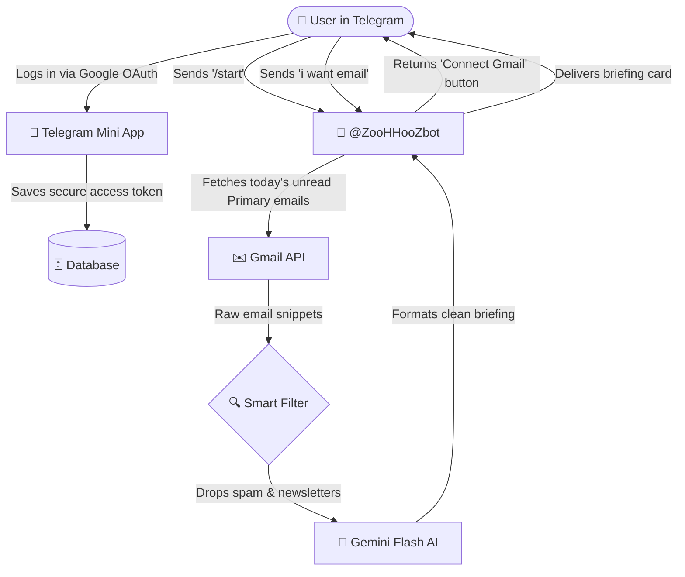

# 📬 emailZooH — AI-Powered Telegram Gmail Assistant

A simple, fast, and secure Telegram bot that connects to your Gmail and delivers clean **AI summaries** of your **unread Primary emails received today** on demand.

Runs 100% in the cloud on **Vercel** — no local servers needed.

---

## 💡 What Does This Project Do?

Most inboxes are flooded with promotional emails, newsletters, and automated notifications. Finding genuine emails that need attention is frustrating.

**emailZooH solves this:**
1. Text the Telegram bot: **`i want email`**.
2. It fetches your inbox in real-time.
3. It filters out **100% of marketing, promotions, and automated newsletters**.
4. It extracts only real personal/work messages **received today**.
5. Google's **Gemini AI** summarizes them into an executive briefing delivered back to your Telegram chat in seconds!

---

## 🔄 How It Works



---

## ✨ Features

* **📱 Telegram Mini App Integration:** Connect your Google account directly inside Telegram with 1 tap.
* **🛡️ Strict Primary-Only Filter:** Inspects RFC email headers (`List-Unsubscribe`, `Feedback-ID`, `Precedence: bulk`) to eliminate promotional spam.
* **📅 Today-Only Filter:** Strictly processes emails received during the current calendar day.
* **🧠 Gemini Flash AI Briefings:** Neatly categorizes updates into:
  * 🔴 **Action Required** (Tasks, replies, deadlines)
  * 🟢 **General Messages** (1-sentence quick takeaways)
* **☁️ 100% Cloud-Hosted:** Deployed serverless on **Vercel** with zero local dependencies.

---

## 📱 How to Use

1. **Start the Bot:** Open Telegram and message [@ZooHHooZbot](https://t.me/ZooHHooZbot).
2. **Link Account:** Send `/start` and tap the **Connect Gmail** button.
3. **Get Your Briefing:** Send `i want email` anytime!

---

## 📁 Repository Structure

```
gmail-updates/
├── api/
│   └── index.py             # Vercel Serverless router & path middleware
├── backend/
│   ├── app.py               # FastAPI server (webhooks, auth, routes)
│   ├── config.py            # Configuration & environment variables
│   ├── database.py          # Dual storage (SQLite + Supabase)
│   ├── gmail_service.py     # Gmail OAuth & strict header filtering
│   ├── ai_service.py        # Gemini Flash AI summarizer
│   └── telegram_service.py  # Telegram message & UI buttons
├── frontend/
│   ├── index.html           # Telegram Mini App UI
│   └── privacy.html         # Public Privacy Policy
├── vercel.json              # Vercel configuration
├── requirements.txt         # Python dependencies
└── PROJECT_GUIDE.md         # Detailed beginner-friendly guide
```

---

## ⚙️ Environment Variables

| Variable | Description |
| :--- | :--- |
| `TELEGRAM_BOT_TOKEN` | Bot API token from `@BotFather` |
| `GOOGLE_CLIENT_ID` | OAuth Client ID from Google Cloud Console |
| `GOOGLE_CLIENT_SECRET` | OAuth Client Secret from Google Cloud Console |
| `GEMINI_API_KEY` | API key from Google AI Studio |
| `BASE_URL` | Production URL (`https://email-zoo-h.vercel.app`) |

---

## 🔒 Privacy & Security

* **Read-Only:** The bot only requests `gmail.readonly` permission. It cannot send or delete emails.
* **Transient:** Emails are summarized in real-time in memory and never stored on disk.
* **Revocable:** Disconnect at any time from [Google Permissions](https://myaccount.google.com/permissions).

---

## 🌐 Live Links

* **Telegram Bot:** [@ZooHHooZbot](https://t.me/ZooHHooZbot)
* **Production App:** [https://email-zoo-h.vercel.app](https://email-zoo-h.vercel.app)
* **Privacy Policy:** [https://email-zoo-h.vercel.app/privacy](https://email-zoo-h.vercel.app/privacy)
